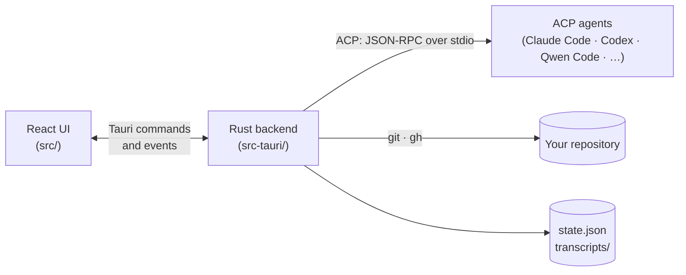

# Zorvo

[](https://github.com/zakyirsyaad/zorvo/actions/workflows/ci.yml)
[](https://github.com/zakyirsyaad/zorvo/actions/workflows/security.yml)
[](https://github.com/zakyirsyaad/zorvo/releases)


**Every coding agent. One desktop.**

A desktop app for the coding agents you already use. Claude Code, Codex,
Qwen Code, Gemini CLI and the other agents in the
[ACP registry](https://agentclientprotocol.com) run in a real chat UI. It is
like Claude Code Desktop, but for whichever agent you have.

- [Highlights](#highlights)
- [Supported agents](#supported-agents)
- [Requirements](#requirements)
- [Install](#install)
- [Getting started](#getting-started)
- [Privacy and your data](#privacy-and-your-data)
- [Troubleshooting](#troubleshooting)
- [How it works](#how-it-works)
- [Development](#development)
- [Releasing](#releasing)
- [Roadmap](#roadmap)
- [License](#license)

## Highlights

- **The agent's own data.** Every agent is driven over the
  [Agent Client Protocol](https://agentclientprotocol.com). You get:
  - their real modes and models;
  - permission requests with the agent's own choices;
  - a diff of every file change;
  - slash commands, including the ones your skills and plugins add, and
    context usage;
  - sessions that resume after a restart.
- **An agent catalog.** Settings → Agents lists every agent in the ACP
  registry, with search. Add, install, update and remove agents there;
  Zorvo installs what an agent needs, Node.js or `uv` included.
- **Sign in from inside Zorvo.** An agent's own login runs in a terminal in
  the app.
- **Agents can ask you.** An agent can show a form in the chat, or send you
  to a web page to sign in. What you type there goes to the agent and is
  never saved.
- **Pick up where you left off.** Continue a session you started in the
  agent's own CLI from the new-session screen.
- **Workspaces and sessions.** Sessions are grouped by folder, titled from
  the first message, and saved on disk. You can rename, pin and archive them.
  An unread mark shows which agent finished while you were elsewhere, and a
  session can pop out into its own window.
- **Fork and rewind.** Fork any reply into a new session, or rewind to
  before one of your messages and send it again, edited.
- **Worktrees.** Run a session in its own git worktree on an
  `agent/<title>` branch, so agents in the same repository never edit the
  same files. Pick the branch it starts from, or switch your folder to
  another branch, from the folder list.
- **A terminal where the agent works.** The **Terminal** button opens a shell
  in the session's folder (its worktree, when it has one), in a drawer under
  the chat. Each folder keeps its own tabs. Closing a tab or quitting Zorvo
  ends the shell and what it started. A worktree's terminals end when Zorvo
  removes that worktree; a kept or shared worktree keeps them.
- **Review and commit.** The Changes panel shows each changed file's diff
  and commits the files you choose. The top bar shows the branch's pull
  request and its checks, and the panel lists your pull requests. All of
  this is read with your own `gh`.
- **The composer.** Before a session starts, pick its agent, folder, model,
  effort and permission mode; your last model and effort are remembered. You
  can also:
  - mention files with `@`;
  - drop files onto the window;
  - click the context meter to see tokens used, tokens left and cost.

## Supported agents

Zorvo reads the [ACP agent registry](https://agentclientprotocol.com) and runs
its agents as chats. Zorvo checks the registry in the background at startup
when the last check is over a day old, and when you click **Check again** in
Settings → Agents. Only the agents in use show up: Claude Code, Codex and Qwen Code by
default, plus any registry agent that is already installed on your Mac. Add
other registry agents from Settings → Agents. A new version of an agent is
offered a week after it was published, and never one the registry has
withdrawn.

| | Qwen Code | Claude Code | Codex |
|---|---|---|---|
| Runs as | ACP agent via `npx` | ACP agent via `npx` | ACP agent via `npx` |
| View | chat | chat | chat |
| Models, effort, modes | from the agent | from the agent | from the agent |
| Approvals | in the chat | in the chat | in the chat |
| Resume after a restart | when the agent can resume or load sessions | when the agent can resume or load sessions | when the agent can resume or load sessions |
| Rewind | yes | yes | yes |
| Fork | yes | yes | yes |

The table shows the default agents; every other registry agent works the
same way. The ACP agents report their own models, efforts and approval modes
for each session, so the app offers whatever your install has. Zorvo
continues an earlier session with the agent's own resume (ACP
`session/resume`) when it offers one, and otherwise loads it
(`session/load`). An agent that can do neither says so when you try to
continue one.

A fork from the latest reply uses the agent's own fork when it has one.
Otherwise it is done by handoff: the conversation is written to a file, and
the new agent is asked to read it and wait for your next message.

## Requirements

- macOS (Apple Silicon or Intel).
- **Node.js 22+, yours or Zorvo's,** for Claude Code, Codex, Qwen Code and
  any other registry agent that runs with `npx`. Zorvo uses yours when it is
  on your login shell's `PATH` (nvm, Homebrew…) and is 22 or newer. Otherwise
  it installs Node.js when you click **Install** on an agent that needs it. The
  first start downloads the agent's pinned package.
- **At least one agent, signed in.** Agents sign in with their own tools. A
  global install is optional: it only makes an agent show up as installed
  before you first use it.

  | Agent | Optional global install | Sign in |
  |---|---|---|
  | Qwen Code | `npm i -g @qwen-code/qwen-code` | run `qwen` once |
  | Claude Code | `npm i -g @anthropic-ai/claude-code` | `claude`, then `/login` (or the app's sign-in panel) |
  | Codex | `npm i -g @openai/codex` | `codex login` (or the app's sign-in panel) |

- **Optional: the [GitHub CLI](https://cli.github.com)**, signed in with
  `gh auth login`, for pull request status. Without it, that part is hidden.

The app reads your login shell's environment, so anything your terminal finds,
it finds too. If you install an agent while the app runs, click **Check again**
in Settings → Agents.

## Install

Download the `.dmg` from the
[latest release](https://github.com/zakyirsyaad/zorvo/releases) and
drag Zorvo into Applications.

The build is not yet signed, so macOS blocks it the first time you open it.
Open it once, then go to **System Settings → Privacy & Security** and click
**Open Anyway** next to the Zorvo message. macOS 15 no longer offers
right-click → Open for this. You can also run this in a terminal:

```bash
xattr -dr com.apple.quarantine "/Applications/Zorvo.app"
```

**Upgrading from Agent Desktop.** Zorvo is a new app next to the old one. On
first launch it copies your sessions and transcripts. Then delete Agent
Desktop from Applications: both apps share the old sessions' worktrees, so
deleting a session in one removes its worktree for the other. macOS asks
again for notification and folder permissions, since they belong to the app's
identifier.

## Getting started

1. **Onboarding.** The first run checks which agents are installed, lets you
   pick a default, and asks for a project folder. Add more agents later in
   Settings → Agents.
2. **Start a session.** Click **+ New** (or the **+** next to a folder to
   choose its agent). Pick the folder, branch, model, effort and permission
   mode in the composer, and send your first message. Turn on **Worktree**
   first to give the session its own checkout.
3. **Work with the agent.**
   - Answer its permission requests in the chat.
   - Open **Files** to browse the folder and **Changes** to review and commit
     what it changed.
   - Open **Terminal** for a shell in the same folder.
   - Use the top bar to go back and forth between sessions.
4. **Branch off.**
   - **Fork** under any reply starts a new session from there.
   - **↺ Rewind** under one of your messages takes the conversation back to
     before it and puts the message in the composer to edit. It needs a
     confirming second click, and files the agent changed stay as they are.

Each session starts in the safest permission mode its agent offers (its
**Default**, **Manual**, **Ask** or **Read-only** mode), so the agent asks
before it edits files or runs commands. Pick another mode in the composer.

## Privacy and your data

- **Sign-in stays with the agents.** The app never asks for or stores API
  keys or tokens. Agents sign in with their own tools, and pull request data
  comes from your own `gh` login.
- **A few hosts, all named.** Zorvo's backend contacts these hosts, and only
  these:
  - the ACP registry (`cdn.agentclientprotocol.com`), to list agents and
    their versions, and to fetch their logos (SVG files from the same host);
  - the download URLs the registry lists, and the HTTPS hosts they redirect
    to (for example `release-assets.githubusercontent.com`), when you
    install a binary agent;
  - `nodejs.org`, when you install an agent that needs Node.js and yours is
    missing or older than 22;
  - `uv`'s releases on GitHub, when you install an agent that runs with
    `uvx` and you have no `uvx`.

  Every download is checked against a SHA-256 hash that was pinned before
  the download, and nothing downloads until you click **Install**. Zorvo
  sends no telemetry, and the window makes no network requests: its Content
  Security Policy only allows the local IPC bridge. The tools your agents
  run make their own requests. `npm` and `npx` fetch packages from the npm
  registry (this includes `pi`, which Zorvo installs with `npm` for the Pi
  agent), and `uvx` can download Python and PyPI packages. Your agents talk
  to their own services as they always do. When an agent asks you to sign
  in on a web page, the page opens in your default browser after you click
  **Open in browser**; Zorvo makes no request for it.
- **Where your data lives.** Sessions and transcripts are stored in
  `~/Library/Application Support/xyz.zorvo.desktop/`, as `state.json` and
  `transcripts/`. Session worktrees live in `worktrees/` there. On first
  launch, Zorvo copies sessions and transcripts from the folder earlier builds
  used (`com.agentdesktop.app/`) and leaves that folder as it was.
- **Folder limits.** The backend only reads and runs in folders you opened in
  the app.

## Troubleshooting

| Problem | What to try |
|---|---|
| An agent shows as not installed | Click **Add** or **Install** next to it in Settings → Agents, or choose it in a new session's agent picker (it is labelled "(not installed)") and click **Install**. Zorvo brings Node.js when yours is missing or older than 22, and `uv` for agents that need it. A registry agent also counts as installed when its binary is on your `PATH` or its npm package is installed globally. Then click **Check again** in Settings. |
| "Sign in to *agent*": the agent needs you to sign in before it can start | Use a sign-in method the panel offers, or sign in once in a terminal (see [Requirements](#requirements)), then send your message again. |
| Claude Code, Codex or Qwen Code does not start | When you click **Install** and your Node.js is missing or older than 22, Zorvo installs Node.js for them. The first start downloads the agent's pinned package, so it can take a moment. |
| No pull request status | Install `gh` and run `gh auth login`. A repository without a GitHub remote has none to show. |
| "is not in the last commit, so a worktree would not have it" | A worktree checks out the last commit. Commit the folder first, or start the session without Worktree. |
| The app is blocked on first open | See [Install](#install). |

## How it works



- **The frontend** (`src/`, React 19 and Tailwind). Every session
  is an ACP chat, run by `hooks/session-engine/useAcpEngine.ts`.
- **The backend** (`src-tauri/src/`, Tauri 2):
  - `acp/`: the ACP client;
  - `pty_session.rs` and `workspace_terminal.rs`: the terminals an agent's own
    sign-in and the workspace shells run in;
  - `registry/`: the ACP agent registry, its dated version history and the
    agents you use;
  - `installer/`: installing agents, Node.js and `uv`, every download checked
    against a pinned hash;
  - `profiles.rs`: the agent profiles and how agents are found;
  - `store.rs`: state and transcripts;
  - `changes.rs`, `worktrees.rs` and `branches.rs`: git;
  - `pull_requests.rs`: `gh`.

## Development

```bash
pnpm install
pnpm tauri dev
```

| Check | Command |
|---|---|
| Types and ESLint | `pnpm lint` |
| Frontend tests | `pnpm test` |
| Rust tests | `cd src-tauri && cargo test` |
| Rust lint | `cd src-tauri && cargo clippy --all-targets -- -D warnings` |
| Production build | `pnpm tauri build` |
| Refresh the bundled registry history | `pnpm registry:update` |

To run the fast checks before each commit (types, ESLint, `cargo fmt`), opt in
with `pnpm lefthook install`.

On every pull request, CI runs the types, ESLint, the tests and the Rust lint.
It also runs CodeQL and a dependency audit (`pnpm audit`, `cargo audit`), and
Dependabot proposes updates weekly.

CI does not build the release bundle. Before a release, run
`pnpm tauri build` and open the app: the production build is the only one that
applies the Content Security Policy.

See [CONTRIBUTING.md](CONTRIBUTING.md) for how to propose a change,
[SECURITY.md](SECURITY.md) for how to report a vulnerability, and
[CHANGELOG.md](CHANGELOG.md) for what changed in each release.

## Releasing

1. Bump the version in `package.json`, `src-tauri/Cargo.toml` and
   `src-tauri/tauri.conf.json`. In `CHANGELOG.md`, rename `Unreleased` to the
   new version with its release date, add its compare link, and start a new
   empty `Unreleased` section.
2. Tag and push: `git tag vX.Y.Z && git push origin vX.Y.Z`.
3. The **Release** workflow builds a universal macOS app and attaches it to a
   draft GitHub release. Publish the draft when it looks right.

To sign and notarize the app, so Gatekeeper opens it without a warning, add
these repository secrets from an Apple Developer account:

- `APPLE_CERTIFICATE` (a base64 `.p12`)
- `APPLE_CERTIFICATE_PASSWORD`
- `APPLE_SIGNING_IDENTITY`
- `APPLE_ID`
- `APPLE_PASSWORD` (an app-specific password)
- `APPLE_TEAM_ID`

Without them, the build is unsigned.

## Roadmap

- A signed and notarized build, so macOS opens it without a warning.
- Updates inside the app.
- Windows and Linux builds.
- Undoing an agent's file changes along with a rewind.
- End-to-end tests of the built app.

## License

No license has been granted yet, so all rights are reserved by the author.
