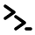

# Zorvo brand brief

Agreed on 2026-10-18. This brief names the product, says what it promises
and to whom, and fixes the logo, color, type and voice. What is still to do
is under [Open items](#open-items).



## The product in one line

**Zorvo — every coding agent, one desktop.** A native macOS app where the
coding agents a developer already uses (Claude Code, Codex and Qwen Code over
ACP; Aider and Oh-My-Pi as real terminals) live side by side, with their own
modes, models, permissions and diffs.

## Positioning

| | |
|---|---|
| Audience | Individual developers who use more than one coding agent, worldwide. English first. |
| Business model | Freemium: the desktop app is free, a Pro plan is paid monthly or yearly. |
| Core promise | Vendor-neutral. Bring your own agent: no lock-in, no API keys, switch any time. |
| Against | Single-vendor apps (an agent maker's own desktop app) and tools built around one agent. The difference is neutrality, not speed. |

Every piece of copy should be traceable to the core promise. If a claim does
not say "any agent, one place, yours", it probably does not belong.

## Name

**Zorvo**, said *ZOR-voh*. An invented word: two syllables, hard
consonants, an open vowel at the end. It means nothing on its own, so the
tagline and the symbol carry the meaning.

- **Domain:** `zorvo.xyz` was unregistered on 2026-10-18 (registry RDAP).
  `zorvo.dev` had no nameservers. `.com`, `.app`, `.io` and `.ai` are held
  but served no site.
- **Collisions found:** none in software. The nearest name is Zorvolex, a
  prescription drug: different industry, low risk.
- **Always** written `Zorvo` in prose and `zorvo` in the wordmark. Never
  `ZORVO`, `ZorVo` or `Zorvo App`.

### Names considered and dropped

Kept so the same ground is not searched twice.

| Name | Why it was dropped |
|---|---|
| Agent Desktop | Generic, cannot be trademarked, and Agent Desk already exists in the same category. |
| Anyterm | An open-source web terminal of the same name has existed since 2005. |
| Hearth, Roost, Waystation, Termiq, Kondukt | Existing AI-agent or terminal products, or a sound-alike of one (Conductor). |
| Termyx, Konsol | Too close to Termux and KDE Konsole. |
| Shelix, Plurix | Clean, but not chosen. |

## Voice

Futuristic and a little mysterious in what it says, clean and quiet in how it
looks. Short declarative sentences. Confident, never loud.

| Do | Don't |
|---|---|
| "Every coding agent. One desktop." | "The ultimate AI-powered coding experience!" |
| "Bring the agent you already use." | "Seamlessly unlock your agents' potential." |
| "No lock-in. No API keys." | "Simply connect and you're good to go." |
| Name the agents: Claude Code, Codex, Qwen, Aider. | Hide behind "AI" in general. |

- Sentence case for headings and buttons.
- No exclamation marks, and no "seamless", "unlock", "empower", "simply".
- Other agents' names are used only to say Zorvo works with them, never in a
  way that suggests a partnership or endorsement.

### Messaging

- **Tagline:** Every coding agent. One desktop.
- **Supporting line:** Claude Code, Codex, Qwen and Aider in one native app.
  Bring the agent you already use. No lock-in, no API keys.
- **Short line (social, App Store subtitle):** Every agent, one prompt.

## Logo

The logo is the **double prompt** symbol beside the `zorvo` wordmark.

- **Symbol:** two `>` prompts stepping down and to the right, ending in a
  `_` cursor. The steps trace a Z; the prompts say "terminal"; two of them
  say "more than one agent".
- **Wordmark:** `zorvo` in Instrument Sans SemiBold (600), lowercase,
  letter-spacing −4% (−1.5px at 38px).
- **Stroke:** the symbol's stroke matches the wordmark's stem weight
  (3.6 units on the 40-unit grid). Round caps and joins.
- **Lockup:** symbol left, wordmark right, gap = 30% of the symbol's height.
  Clear space on every side = the symbol's height.

| File | Use |
|---|---|
| [`assets/zorvo-symbol.svg`](assets/zorvo-symbol.svg) | The symbol, 32px and up. |
| [`assets/zorvo-symbol-small.svg`](assets/zorvo-symbol-small.svg) | Favicon and menu bar, under 32px: no cursor, heavier stroke. |

Both draw in `currentColor`, so they take the color of the text around them.

- **App icon:** the symbol in `#FAFAFA` on a `#0A0A0A` macOS squircle,
  the symbol's 40-unit grid at 55% of the tile (the strokes themselves span
  about 45%).
- **Don't:** recolor the symbol, add gradients or glows, outline it, rotate
  it, or set the wordmark in another typeface.

### App icon

`src-tauri/icons/` is generated from the SVGs in `assets/`. To regenerate
it after changing them, run (macOS, with Pillow 9.1 or later and pnpm):

```bash
python3 scripts/generate-app-icon.py
```

The script reads the symbol geometry from both SVGs (only `M`, `L`, `H` and
`V` path commands), draws a 1024px master of each, runs
`pnpm tauri icon` on the full master, and then swaps in the small variant
for every image under 32px: the 16 and 24 entries in `icon.ico`, the 16px
`ic04` entry in `icon.icns` (rebuilt with `iconutil`; `ic11`, the 16@2x
entry, is 32px and keeps the full symbol), `Square30x30Logo.png`, and the
iOS `AppIcon-20x20@1x.png` and `AppIcon-29x29@1x.png`. Run on unchanged
SVGs, it reproduces the committed icons byte for byte.

To draw only the two masters, run
`python3 scripts/generate-app-icon.py --masters-only <out_dir>`.

## Color

Monochrome, on the zinc scale (the same values as Tailwind's `zinc`, which
the app already ships with). No brand accent: the symbol and the type are
the identity.

| Token | Hex | Use |
|---|---|---|
| `ink` | `#0A0A0A` | Dark background, text on light |
| `zinc-800` | `#27272A` | Raised surfaces on dark |
| `zinc-500` | `#71717A` | Secondary text |
| `zinc-200` | `#E4E4E7` | Borders on light |
| `paper` | `#FAFAFA` | Light background, text on dark |

Color appears only where it means something in the product: an agent
working, a diff line added or removed, a failed check. Those status colors
are UI tokens, not brand colors, and never appear in the logo or marketing
headlines.

Dark is the default for marketing; the app follows the system theme.

## Typography

Both fonts are free for commercial use under the SIL Open Font License.

| Font | Use |
|---|---|
| Instrument Sans | Wordmark (600), headlines (500), UI and body (400) |
| Geist Mono | Code, commands, keyboard shortcuts |

Headlines are set tight (−3% to −4% letter-spacing) and short, usually two
lines. If a paid typeface is wanted later, the closest match in spirit is
Söhne.

## Open items

Item 3 and the app icon in item 4 are done; the rest are not, and each is
its own piece of work:

1. **Buy `zorvo.xyz`** (and `zorvo.dev` if it is free). Unregistered names
   can be taken at any time.
2. **Trademark search** for "Zorvo" in classes 9 and 42 (USPTO, EUIPO)
   before spending on the name. The checks above were web searches and
   domain lookups only.
3. ~~**Rename the app in code.**~~ Done in zakyirsyaad/agent-desktop#32
   (merged as `21ea46e`): `productName` is `Zorvo`, the bundle identifier is
   `xyz.zorvo.desktop`, and a one-time migration moves existing sessions and
   transcripts out of the old `com.agentdesktop.app` data directory.
4. **App icon and favicon.** The app icon is done in
   zakyirsyaad/agent-desktop#32: every size Tauri bundles is generated from
   the SVGs; see [App icon](#app-icon). A web favicon (from
   `assets/zorvo-symbol-small.svg`) is still to do, with the landing page.
5. **Homebrew cask** if the landing page is to offer
   `brew install --cask zorvo`; until it exists, the page offers the `.dmg`.
6. **Pro plan scope:** which features are paid.
